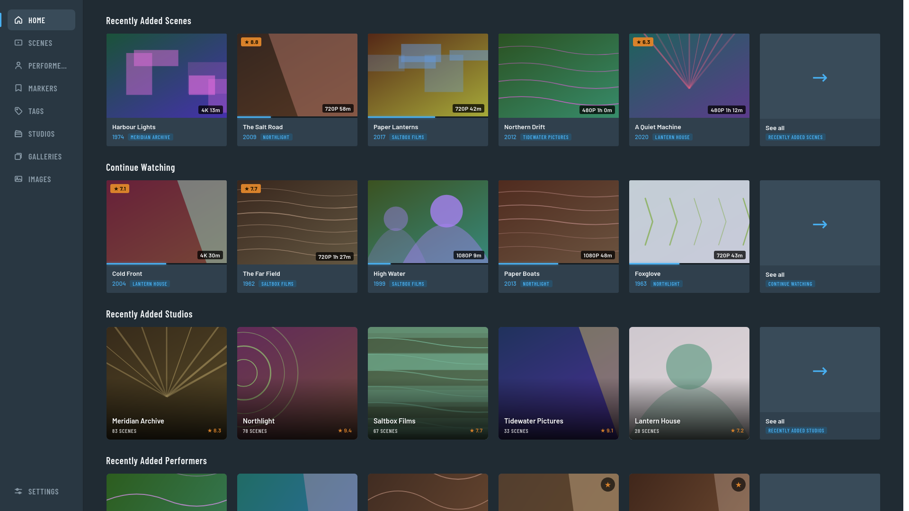
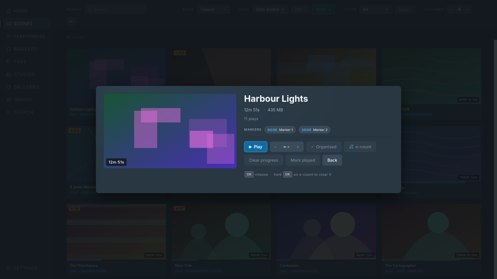
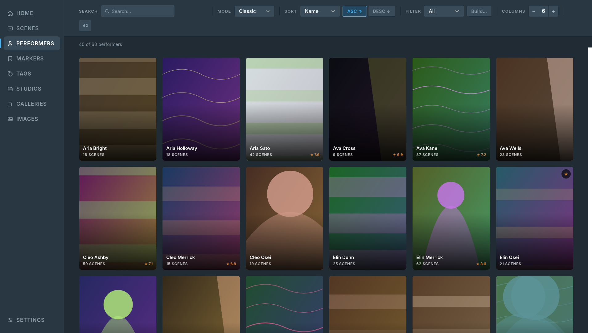
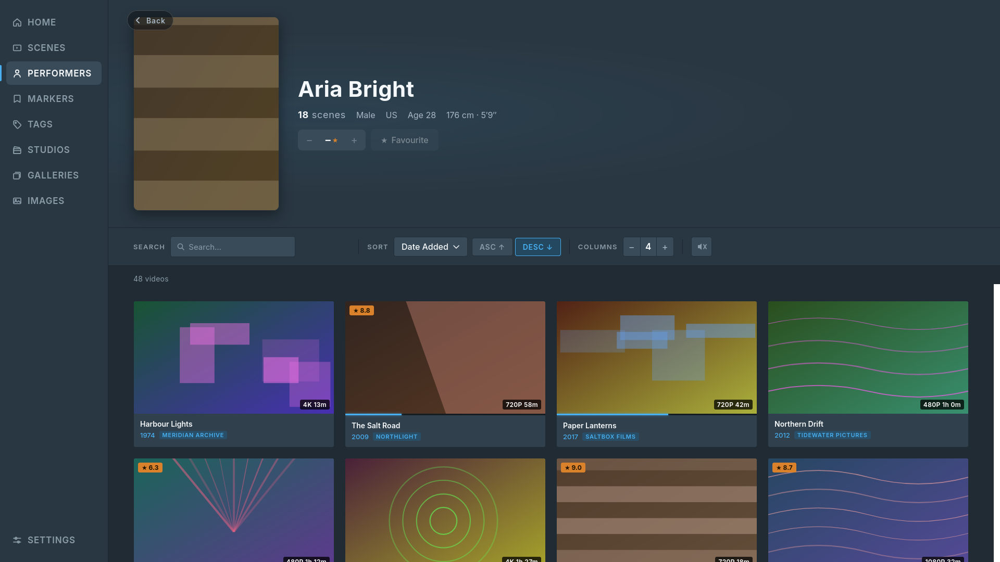
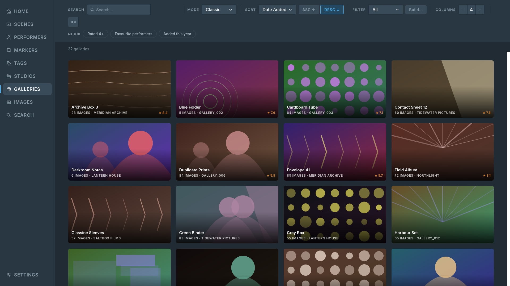
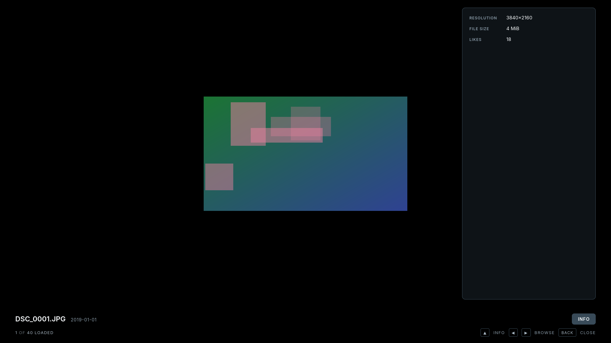
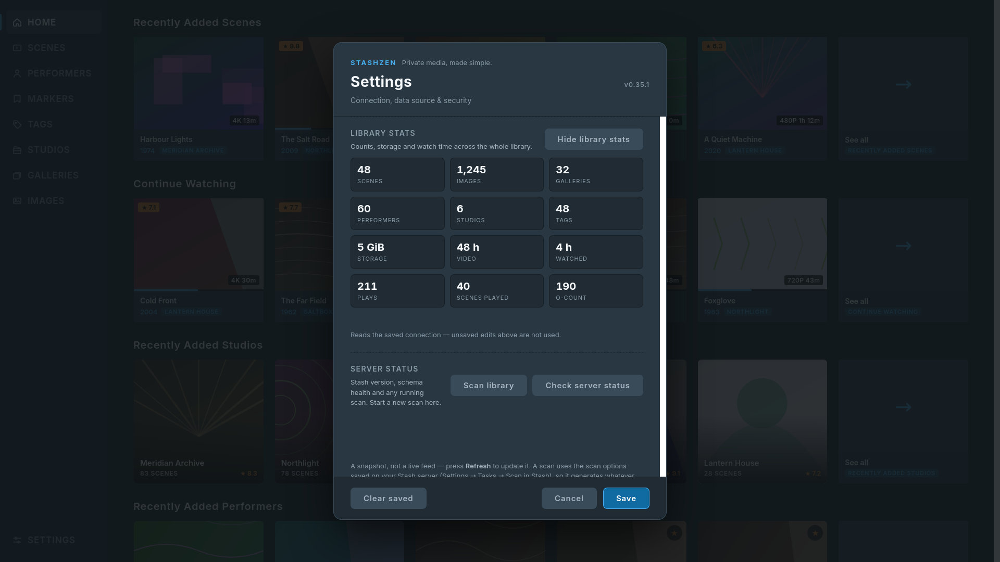
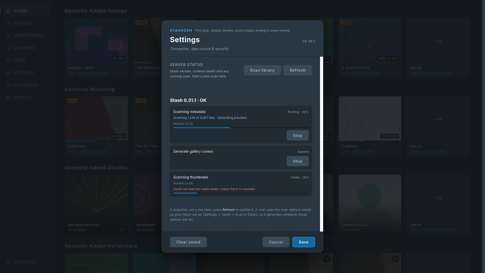

# StashZen

**Private media, made simple.**

A [Stash](https://github.com/stashapp/stash) client for Samsung Tizen TVs, built to be driven
entirely with the remote. It is a web app packaged as a Tizen widget (`.wgt`).

[Project page](https://stashified.github.io/StashZen/) ·
[Releases](https://github.com/Stashified/StashZen/releases) ·
[Issues](https://github.com/Stashified/StashZen/issues)

---

## What you need

- A Samsung TV running **Tizen 6.5 or newer** (most sets from 2022 onwards).
  *Tested on Tizen 9 (S95H) only.* Earlier releases ship older browser engines that cannot render
  this layout — flex `gap` needs Chromium 84 and `aspect-ratio` needs 88 — so the package declares
  Tizen 6.5, the first release on Chromium 94. Other models on 6.5+ are otherwise untested: if
  StashZen misbehaves on yours, please open an issue with the model and Tizen version.
- A reachable **Stash server** on the same network. Built and tested against Stash **0.31.1**.
- The **`.wgt` file** for the latest version — from the
  [Releases](https://github.com/Stashified/StashZen/releases) page.

## Install on the TV (sideload)

This is the intended way to install StashZen. Download the `.wgt` from **Releases**, not the zip
from an Actions run — a workflow artifact is a zip containing the `.wgt`, and installers fail on it
without saying why.

1. **Enable Developer Mode on the TV.** Open **Apps**, press **1 2 3 4 5** on the remote, turn on
   *Developer mode*, enter the IP of the computer you will install from, and restart the TV.
2. **Install the file** with [Apps2Samsung](https://github.com/Apps2Samsung/Apps2Samsung) or a
   similar tool: select the `.wgt` and let it do the rest. Tizen Studio's `tizen install` works too;
   it needs a package signed with a Samsung distributor certificate that lists your TV (see
   [Building your own package](#building-your-own-package)).
3. StashZen appears in the TV's Apps grid.

The app opens on its Setup screen the first time — see below.

## First run

A fresh install has no server address saved, so it opens on **Connect to Stash**:

- **Server address** — include `http://` and the port, e.g. `http://192.168.1.20:9999`. `9999` is
  Stash's default; use your own if you changed it.
- **API key** — in Stash, under **Settings → Security → API Key**.
- **Connect** tests the address and key before saving. **Skip — use sample data** leaves everything
  unsaved and runs in Test mode, so you can look around first.

The app then offers an optional **4-digit PIN**, asked for on the *next* launch. To change any of
this later, open **Settings → Connection setup → Run setup again**.

Text fields select first and edit on OK: moving onto a field does not raise the keyboard — press
**OK** to start typing, and **OK** again (or the keyboard's Done) to finish.

## Screenshots

<p align="center">
  
  
</p>
<p align="center">
  
  
</p>
<p align="center">
  
  
</p>
<p align="center">
  
  
</p>

<sub>Captured from the app's built-in Test mode; it runs on sample data and needs no server.</sub>

## Remote controls

| Key | Action |
|---|---|
| D-pad | Move focus. |
| OK / Enter | Open the focused item or activate the control. On a card this opens its detail page. |
| Back / Esc | Close the topmost thing — dropdown, page, player. With the player's controls on screen, the first press hides them and the second closes the player. In the image viewer, an open info panel closes first. On the main screen it asks to exit. |
| ← from a card | Returns to the left rail's current tab. |
| ↑ from the top card row | On a listing tab, jumps to the controls bar (filter, sort, view mode, search). On Home, goes back to the rail. |
| ↑ / ↓ on the rail | Walks the rail, including Settings at the bottom. |
| OK on the rail's current row | Reloads that tab in place — re-reads its listing, so scenes added or removed on the server appear without relaunching. |
| ↑ in the image viewer | Reaches the **Info** button; **OK** opens that image's metadata panel. |
| ← / → in the image viewer | Previous or next image. With the info panel open it stays open and reloads for the new image. |
| OK on a gallery chip | A scene detail's **Galleries** row opens that gallery in the Galleries tab. |
| ← / → in the player | Seek 15 seconds. |

## Features

- **Home** — Stash's shelves, five cards each, with **Continue Watching** under Recently Added
  Scenes. **See all** opens a listing with that shelf's sort and filter.
- **Seven sections** — Scenes, Performers, Markers, Tags, Studios, Galleries and Images, each with
  search, sort, filters and four view modes. View mode and columns are remembered per tab; sort,
  filter and search reset on arrival. Gallery cards show the studio, or the folder; tag and studio
  carousels carry Stash's description and aliases. A marker plays its scene at that timestamp.
- **Filter builder** — build a filter on the TV or load a saved one; saved filters round-trip to
  Stash.
- **Scene detail** — metadata and rating; resume, play from a marker, clear progress or mark
  played; a **Galleries** row when the scene belongs to one.
- **Performer pages** — the full profile plus scene, image and gallery counts, with **Rating** and
  **Favourite** editable and written back to Stash.
- **Image viewer** — full size, stepped with ←/→; **Info** shows what Stash holds for the image.
- **Player** — resumes where you stopped, queues the whole listing, seeks 15 s at a time, and
  writes progress back to Stash. HLS keeps the timeline seekable; the controls say **direct** or
  **transcoded**, and **Playback info** shows the live stream details.
- **Preview on focus** — hovered videos play silently; toggle in Settings.
- **Library stats and server jobs** — counts, storage and watch time; running jobs with progress
  and a two-press **Stop**; start a library scan from the TV.
- **Theme** — Standard or OLED (true black on OLED panels).
- **PIN lock** — optional four-digit code at launch.
- **Test mode** — every screen on sample data, no server required.

## Troubleshooting

**It won't connect or the screen is black.** Open Settings → Test connection. Check that the address
includes `http://` and the port, that the TV can reach the server, and that the API key is current.

**A scene won't play.** The file's codec may need transcoding; enable **transcoding on the Stash
server**. If the spinner never resolves, check Stash's logs first. Playback uses the TV browser's
HTML5 `<video>` rather than Tizen's AVPlay, so the set of containers and codecs it accepts is
narrower than a desktop player's; transcoding is the way around that.

**A transcoded scene won't seek.** That is Stash's MP4 transcode, which is a linear stream. StashZen
uses HLS instead; if you see it, HLS output is disabled or unavailable on your server.

**Progress doesn't sync.** The player shows an indicator when a save fails. Usually it is the API
key: saving activity is a mutation and needs it, unlike plain playback. The performer page's rating
and favourite writes use the same key and report a failure in place.

**An image's Info panel is sparse.** It shows only what Stash holds for that image and hides every
empty field, so a picture with no studio, tags or performers will be short. That is the data, not a
failed fetch.

**The app shows "Something went wrong".** That screen is the last-resort error boundary. **Try
again** re-renders; **Restart** relaunches the widget. If it recurs, note what you were doing and
open an issue — the message on the screen helps.

## Security notes

- **The API key is stored unencrypted on the TV.** StashZen keeps it in the app's local storage.
  The optional PIN is a deterrent for someone holding the remote, not encryption: anyone who can
  read the installed app's storage can read the key regardless of the PIN. Create a dedicated
  Stash API key for the TV and revoke it if the set leaves your control.
- **Media URLs carry the key in their query string.** ``, `<video>`, sprite sheets and VTT
  files cannot send the `ApiKey` header, so StashZen appends `?apikey=…` to those requests. The key
  therefore appears in Stash's and any reverse proxy's access logs, and over plain HTTP it is
  readable on the network. Beyond a trusted LAN, put Stash behind HTTPS; the URL still carries the
  key, but the connection does not expose it in transit.
- **Release packages carry no credentials.** CI sets no `VITE_*` variables and refuses to package a
  bundle containing a key, so a fresh install starts on the Setup screen. A locally built package
  can contain your key — see [Building your own package](#building-your-own-package).

---

## Developer notes

### Run it locally

Requires Node.js 20+ (CI uses 22).

```bash
git clone https://github.com/Stashified/StashZen
cd StashZen
npm install
npm run dev            # http://localhost:5173
```

The dev server starts in **Live mode** against `http://localhost:9999`; point it elsewhere in
Settings, or set these in `.env` (`.env.production` is separate, and is what `npm run build` reads):

| Variable | Effect |
|---|---|
| `VITE_STASH_URL` | Address the app starts with. |
| `VITE_STASH_API_KEY` | API key it starts with. |
| `VITE_USE_MOCK` | `true` starts in Test mode with sample art. |

Other scripts: `npm run lint`, `npm run build`, `npm run preview`, `npm test` (the unit suites),
and `npm run check:compat` — the Tizen 6.5 API and CSS checks, which CI also runs. The offline
checks under `scripts/` remain for the data layer (`npm run test:filters`, `verify:criteria`,
`verify:art`). `scripts/harness/` runs the real components in headless Firefox against a fake
GraphQL endpoint; it catches navigation and layout regressions before a package is built.
`scripts/harness/shoot.sh` captures the README screenshots from the same Test-mode app. The
harness cannot tell you anything about the TV's media pipeline or on-screen keyboard — only the
TV can.

The UI has no fixed stage: it lays out at whatever viewport it is given, so changing the harness
window invalidates its geometry-based expectations.

### Building your own package

A `.wgt` is a signed zip of `dist/` plus `tizen/config.xml`.

1. Install [Tizen Studio](https://download.tizen.org/sdk/Installer/) (the CLI tools are enough).
2. In **Tools → Certificate Manager**, create a **Samsung** profile: an author certificate (you) and
   a distributor certificate (Samsung-issued). Add your TV's DUID to it. The DUID is shown in the
   TV's Developer Mode dialog.
3. Confirm the profile is active (`O` in the Active column):

   ```bash
   tizen security-profiles list
   ```

4. Build, stage and sign with your profile name:

   ```bash
   npm run build
   cp tizen/config.xml tizen/icon.png tizen/icon-black.png dist/
   node scripts/stamp-manifest.mjs
   tizen package -t wgt -s <profile-name> -- ./dist
   ```

   The stamp step puts `package.json`'s version into the staged manifest, so a local package
   claims the version it actually is. To install over sdb as well:

   ```bash
   sdb connect <tv-ip>:26101
   tizen install -n dist/StashZen.wgt -t <tv-sdb-name>
   ```

The result is `dist/StashZen.wgt` (CI adds the version to the artifact name). A package signed with
your distributor certificate installs with `tizen install` **only on the TVs whose DUIDs you
listed**. Apps2Samsung manages certificates per TV and may add the target TV itself, so a shared
build will often work there too — that route is not verified by this project. For sharing with
people you cannot sign for, use TizenBrew or the Samsung Seller Office.

`npm run build` now ends with `scripts/check-bundle.mjs`. If `.env.production` supplied an API key,
the build **fails** rather than producing a package that contains it. A local build that deliberately
bakes the key in for your own TV can opt out with:

```bash
ALLOW_BAKED_KEY=1 npm run build
```

Never share a `.wgt` built that way — it hands the key to whoever installs it.

### Releases (GitHub Actions)

`.github/workflows/build-wgt.yml` builds and signs a `.wgt` in CI. Trigger it by hand from
**Actions → Build Tizen .wgt → Run workflow**, or push a tag to create a GitHub Release with the
package attached:

```bash
git tag v0.30.0
git push origin v0.30.0
```

Add these four secrets to the GitHub **environment named `StashZen`** — the one the workflow
declares in its `environment:` line (a job only sees environment secrets when it names one):

| Secret | Value |
|---|---|
| `TIZEN_AUTHOR_P12` / `TIZEN_AUTHOR_PASSWORD` | base64 of your author `.p12`, and its password |
| `TIZEN_DISTRIBUTOR_P12` / `TIZEN_DISTRIBUTOR_PASSWORD` | base64 of your Samsung distributor `.p12`, and its password |

```bash
openssl base64 -in author.p12 | tr -d '\n'
```

Release packages carry **no credentials**: the workflow sets no `VITE_*` variables and aborts if one
was inlined, so a fresh install always starts on the Setup screen.

### Where things are

```
src/components/         cards, grids, carousel, image viewer, rail, settings, filter builder
src/components/player/  the player's transport, keys, overlays, media and progress hooks
src/pages/              Showroom (Home), Scenes, Performers, performer and scene detail
src/hooks/              D-pad focus and keys, paging, playback source, play queue, editable fields
src/utils/              Stash services, settings store, filters, playback rules, mock art
tizen/                  manifest and icons
scripts/                offline checks, art generation, headless harness, screenshot capture
```

The three places worth reading first: `src/hooks/useKeyHandler.js` (spatial navigation),
`src/utils/settings.js` (runtime config and Test mode), and `src/components/VideoPlayer.jsx`
with its hooks under `src/components/player/` (keys, queue, writes back to Stash).

## License & credits

MIT — see [`LICENSE`](LICENSE). StashZen started from
[`thelastgrim/stash-tizen`](https://github.com/thelastgrim/stash-tizen) and has since been largely
rewritten; thanks to its author.
