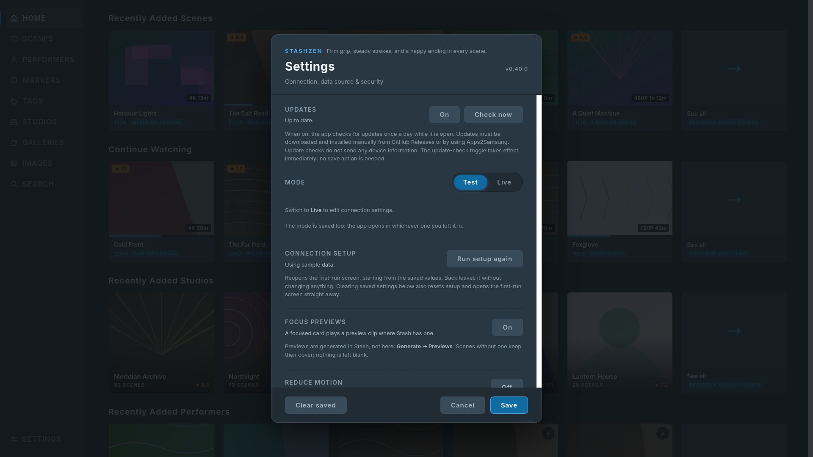

# StashZen

**A Stash client for Samsung Tizen TVs. Firm grip, steady strokes, and a happy ending in every scene.**

Driven entirely with the remote, it is a web app packaged as a Tizen widget (`.wgt`).

[Project page](https://stashified.github.io/StashZen/) ·
[Releases](https://github.com/Stashified/StashZen/releases) ·
[Issues](https://github.com/Stashified/StashZen/issues)

<p align="center">
  
  
</p>

<sub>Captured in Test mode on sample data, not a real library.</sub>

[Install](#install-on-the-tv) · [First run](#first-run) · [Controls](#remote-controls) ·
[Features](#features) · [Troubleshooting](#troubleshooting) · [Security](#security-notes) ·
[Developer notes](#developer-notes)

## Requirements

| | |
|---|---|
| **TV** | Samsung, **Tizen 6.5 or newer** (most sets from 2022 on). |
| **Server** | A **Stash** server reachable on the same network. Tested against Stash **0.31.1**. |
| **Package** | The latest `.wgt` from [Releases](https://github.com/Stashified/StashZen/releases). |

*Tested on Tizen 9 (S95H). The package declares 6.5, the first Tizen on Chromium 94, which this
layout needs (flex `gap` needs 84, `aspect-ratio` 88). Other 6.5+ models are untested; if
StashZen misbehaves on yours, open an issue with the model and Tizen version.*

## Install on the TV

Download the `.wgt` from **Releases**, not an Actions artifact: an artifact is a zip *containing*
the `.wgt`, and installers fail on it without saying why.

1. **Developer mode.** Open **Apps**, press **1 2 3 4 5** on the remote, turn on *Developer mode*,
   enter the IP of the computer you will install from, and restart the TV.
2. **Install the file** with [Apps2Samsung](https://github.com/Apps2Samsung/Apps2Samsung) or a
   similar tool. Tizen Studio's `tizen install` also works but needs a distributor certificate
   that lists your TV (see [Building your own package](#building-your-own-package)).
3. StashZen appears in the TV's Apps grid.

## First run

A fresh install opens on **Connect to Stash**:

- **Server address**: the host and port, e.g. `http://192.168.1.20:9999`. If you leave out
  `http://`, the app adds it.
- **API key**: in Stash under **Settings → Security → API Key**.
- **Test connection** checks the address and key without saving. **Connect** saves only if the
  check passes. **Skip: use sample data** saves nothing and runs in Test mode.

The app then offers an optional **4-digit PIN**, asked on the *next* launch. Change any of this
under **Settings → Connection setup → Run setup again**.

> **Typing:** moving onto a field only selects it. Press **OK** to start editing and raise the
> keyboard, then **OK** again (or **Done**) when you are finished.
>
> The API key is long, and a phone keyboard is easier: the **SmartThings** app on Android, or a
> TV remote app with a keyboard on iPhone, sends what you type straight to the TV. A Bluetooth
> or USB keyboard also works.

## Remote controls

| Key | Action |
|---|---|
| D-pad | Move focus. |
| OK | Open the focused item or activate the control. On a card, opens its detail page. |
| Long press OK | The card's menu; entries depend on the card. Scenes and markers: **Play**, **Play all**, **Play from here**, **Details** (a marker's Play starts at its timestamp; markers also offer edit and delete). Images: **View**, slideshow entries and **Info**. Galleries: **View images**, **Slideshow**, **Shuffle slideshow**. |
| Back / Esc | Close the topmost thing: dropdown, page, player. On Home and the PIN screen it asks to exit. |

**Navigating**

| Key | Action |
|---|---|
| ← from a card | Return to the rail's current tab. |
| ↑ from the top card row | On a listing, the controls bar (filter, sort, view mode, search); on Home, the rail. |
| ↑ / ↓ on the rail | Walk the rail, including Settings at the bottom. |
| OK on the rail's current row | Reload that tab in place, so server changes appear without relaunching. |
| OK on a gallery chip | In a scene detail's **Galleries** row, open the Images tab filtered to that gallery. |

**Player**

| Key | Action |
|---|---|
| ← / → | Seek by **Settings → Seek step**, 5 seconds by default; Adaptive climbs to 10, 30 and 60 on repeated presses. |
| ↓ | Buttons → next scene. Seek bar → back to the buttons first, then **↓** again steps. Controls hidden → steps directly. |
| ↑ | Buttons → seek bar (← / → skim), scene unchanged; **↑** again steps to the previous scene. Controls hidden → steps directly. |
| Back | Controls on screen: first press hides them, second closes the player. |

**Image viewer**

| Key | Action |
|---|---|
| ← / → | Previous or next image. An open info panel stays open and reloads. While zoomed, pan instead. |
| ↑ | Reach **Info**; **OK** opens the image's metadata panel. |
| OK | Zoom 2× and 3×, then back to full size. |
| Back | Close an open info panel, then reset the zoom, then the viewer. |

## Features

**Browse**
- **Home**: five shelves (recent scenes, **Continue Watching**, studios, performers, galleries);
  "see all" opens that shelf's listing.
- **Search**: one field for scenes, performers, tags and studios; "see all" opens that section
  with the query.
- **Seven sections**: Scenes, Performers, Markers, Tags, Studios, Galleries and Images, each with
  search, sort, filters and a view mode remembered per tab. Tags and Studios open as lists.
- **Filters**: build one on the TV or load a saved one, and save it back to Stash. A **Quick**
  row adds one-press chips like Unwatched, Rated 4+ and Has markers.
- **Focus previews**: the focused scene card plays its Stash preview, muted. Turn it off in
  Settings, or mute it from the controls bar.

**Details**
- **Scene detail**: metadata and rating; resume or play from a marker; **Galleries** and
  **More from** rows for the studio and performers.
- **Performer pages**: profile, counts, and **Rating** / **Favourite** written back to Stash.
- **Image viewer**: a slideshow, pan and zoom, and an info panel over the full-size image.

**Playback**
- **Player**: resumes where you stopped, queues the listing, writes progress back to Stash, and
  shows **Direct play** or **Transcoded**.
- **Queue**: a player button opens the queue; OK jumps to a scene, holding OK removes it.
- **Up next**: a card in the last 30 seconds offers the next scene, with **Play now** and
  **Hide**.
- **Seek step**: Settings sets how far the arrows and rail buttons jump, fixed or **Adaptive**.
- **Playback engine**: browser first, with the TV's hardware player for files it cannot take.
  Settings can pin either.
- **Mute**: uses the TV's audio control or the TV player's volume.

**System**
- **Library stats and server jobs**: counts, watch time, running jobs and a library scan.
- **Theme**: Standard or OLED.
- **Reduce motion**: stops fades, slides and focus previews.
- **PIN lock**: optional four-digit code at launch.
- **Unsaved-changes guard**: Settings asks before dropping a change.
- **Test mode**: every screen on sample data, no server.

## More screenshots

<p align="center">
  
  
</p>
<p align="center">
  
  
</p>
<p align="center">
  
  
</p>
<p align="center">
  
</p>

<sub>Captured in Test mode, which runs on sample data and needs no server.</sub>

## Troubleshooting

**It won't connect, or the screen is black.** Use **Settings → Test connection**: the address needs
the host and port (`http://` is added if you leave it out), the TV must reach the server, and the
API key must be current.

**A scene won't play.** Open **Playback info** first; it shows the engine and why.
- The codec may need transcoding: check Stash's logs for ffmpeg errors and confirm the file is
  one Stash can transcode.
- The browser hands files it refuses to AVPlay. If AVPlay is the problem, set
  **Settings → Playback engine → Browser**.
- If the spinner never resolves, check Stash's logs.

**A transcoded scene won't seek.** StashZen uses HLS for transcodes because Stash's MP4 transcode
is a linear stream. If seeking fails, open **Playback info** to see the source. If it is the MP4
fallback, HLS was unavailable or the TV refused it; check Stash's logs for the HLS request. A file
Stash cannot transcode has no HLS stream.

**Progress doesn't sync.** The player shows an indicator when a save fails; usually the API key is
at fault, since saving activity is a mutation. Rating and favourite failures are reported in place.

**An image's Info panel is sparse.** It shows only what Stash holds and hides empty fields. That
is the data, not a failed fetch.

**"Something went wrong".** The last-resort error boundary. **Try again** re-renders; **Restart**
relaunches the widget. Open an issue if it recurs, noting what you were doing.

## Security notes

- **The API key is stored unencrypted on the TV**, in the app's local storage. The PIN is a
  deterrent, not encryption: anyone who can read the app's storage can read the key. Stash has a
  single API key; regenerating it replaces the old one and every client must be updated. If the
  set leaves your control, regenerate the key and enter the new one on each device.
- **Media URLs carry the key in their query string.** Images, video, sprites and VTT files are
  loaded by browser elements that cannot send the `ApiKey` header, so StashZen appends
  `apikey=…` to the URL (`?apikey=…`, or `&apikey=…` when the URL already has a query). The key
  therefore appears in Stash's and any reverse proxy's logs, and over plain HTTP it is readable on
  the network. Beyond a trusted LAN, put Stash behind HTTPS.
- **Release packages carry no credentials.** CI sets no Stash connection variables (no
  `VITE_STASH_URL` or `VITE_STASH_API_KEY`) and refuses to package a bundle containing a key, so a
  fresh install starts on the Setup screen. A package you build locally can contain your key; see
  [Building your own package](#building-your-own-package).

---

## Developer notes

### Run it locally

Requires Node.js 20.19+ or 22.12+ (CI uses 22).

```bash
git clone https://github.com/Stashified/StashZen
cd StashZen
npm install
npm run dev            # http://localhost:5173
```

By default, the dev server starts in **Live mode** against `http://localhost:9999`. Change it in
Settings, or set these in `.env` (a production build also reads `.env.production`, whose values
win):

| Variable | Effect |
|---|---|
| `VITE_STASH_URL` | Address the app starts with. |
| `VITE_STASH_API_KEY` | API key the app starts with. |
| `VITE_USE_MOCK` | `true` starts in Test mode with sample art. |
| `VITE_FORCE_BROWSER` | `true` builds with the browser player only, the rollback lever if a TV's AVPlay misbehaves. Settings then shows the engine in use instead of a switch. |

| Command | What it does |
|---|---|
| `npm run lint` · `build` · `preview` | Vite workflow. `build` also runs the credential guard. |
| `npm test` | The unit suites. |
| `npm run check:compat` | Tizen 6.5 API and CSS checks (CI runs these too). |
| `npm run test:filters` · `verify:criteria` · `verify:art` | Offline checks for the data layer. |

`scripts/harness/` runs the real components in headless Firefox against a fake GraphQL endpoint,
catching navigation and layout regressions before a package is built; `shoot.sh` captures the
screenshots above from the same Test-mode app. It cannot test the TV's media pipeline or
on-screen keyboard. The UI has no fixed stage, so resizing the harness window invalidates its
geometry-based expectations.

### Where things are

```
src/App.jsx             shell: rail, controls bar, overlays, player composition
src/app/                tab config, listing and detail hooks, Back handling
src/components/         cards, grids, carousel, image viewer, rail, settings, filter builder
src/components/player/  transport, keys, overlays, media and progress hooks;
                        engine/ holds the media facade and the browser and AVPlay backends
src/pages/              Home (showroom), Scenes, Performers, Markers, entity pages, detail pages
src/hooks/              D-pad focus and keys, paging, playback source, play queue, editable fields
src/utils/              Stash services, settings store, filters, playback rules, mock art
tizen/                  manifest and icons
scripts/                offline checks, art generation, headless harness, screenshot capture
```

Read first: `src/hooks/useKeyHandler.js` (spatial navigation), `src/utils/settings.js` (runtime
config and Test mode), and `src/components/VideoPlayer.jsx` with `src/components/player/`.

### Building your own package

A `.wgt` is a signed zip of the staged `dist/` directory, which includes `config.xml`.

1. Install [Tizen Studio](https://download.tizen.org/sdk/Installer/) (the CLI tools are enough).
2. In **Tools → Certificate Manager**, create a **Samsung** profile: an author certificate (you)
   and a Samsung-issued distributor certificate listing your TV's DUID, shown in the TV's
   Developer Mode dialog.
3. Confirm it is active (`O` in the Active column): `tizen security-profiles list`
4. Build, stage and sign:

   ```bash
   npm run build
   cp tizen/config.xml tizen/icon.png tizen/icon-black.png dist/
   node scripts/stamp-manifest.mjs     # writes package.json's version into the manifest
   tizen package -t wgt -s <profile-name> -o . -- ./dist
   ```

   To install over sdb as well:

   ```bash
   sdb connect <tv-ip>:26101
   tizen install -n StashZen.wgt -t <tv-sdb-name>
   ```

The result is `StashZen.wgt` in the project root (CI adds the version). `tizen install` expects
your TV's device ID in the certificate; **Apps2Samsung does not**. It installs packages whose
certificate names no real TV, so a shared build works there. For wider sharing, use TizenBrew or
the Samsung Seller Office.

**Credential guard.** `npm run build` ends with `scripts/check-bundle.mjs`, which **fails** if the
bundle contains a JWT-shaped key or the exact `VITE_STASH_API_KEY` from `.env.production`. A
private-network address only warns. It catches the mistake that actually happens (inlining
`.env.production`), not an encoded key. To bake a key in deliberately for your own TV:

```bash
ALLOW_BAKED_KEY=1 npm run build     # never share a .wgt built this way
```

### Releases (GitHub Actions)

`.github/workflows/build-wgt.yml` builds and signs a `.wgt`. Run it from
**Actions → Build Tizen .wgt → Run workflow**, or push a tag to create a GitHub Release with the
package attached:

```bash
git tag vX.Y.Z && git push origin vX.Y.Z
```

Add four secrets to the GitHub **environment named `StashZen`** (the workflow's `environment:`
line; without it the secrets resolve empty):

| Secret | Value |
|---|---|
| `TIZEN_AUTHOR_P12` / `TIZEN_AUTHOR_PASSWORD` | base64 of your author `.p12`, and its password |
| `TIZEN_DISTRIBUTOR_P12` / `TIZEN_DISTRIBUTOR_PASSWORD` | base64 of your Samsung distributor `.p12`, and its password |

Encode a certificate with `openssl base64 -in author.p12 | tr -d '\n'`.

A **tag** build needs all four and never falls back to Tizen's test distributor. A **manual run**
may set `signing: test` (Tizen's bundled test distributor, no distributor secrets) to exercise the
pipeline; never publish the result. The author pair is required either way. Releases carry no
credentials (see [Security notes](#security-notes)).

## License & credits

MIT, see [`LICENSE`](LICENSE). StashZen started from
[`thelastgrim/stash-tizen`](https://github.com/thelastgrim/stash-tizen) and has since been largely
rewritten; thanks to its author.
